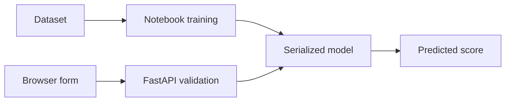

# Manasik Santhulan Score

An educational machine-learning prototype exploring relationships between student social media habits and a predicted mental-health score. Includes a training notebook, dataset, serialized model, FastAPI backend and HTML/CSS/JavaScript frontend.

## Run locally

```bash
python -m venv .venv
# Activate the environment
pip install -r requirements.txt
uvicorn main:app --reload
```

Run from the repository root so the model path resolves. API documentation is available at `/docs`.

## Responsible use

This is not a clinically validated assessment or diagnostic tool. Do not use predictions for medical, educational or employment decisions about individuals. Review dataset consent, provenance, privacy and subgroup performance. Load pickle files only from trusted sources.

## Repository hygiene

Remove the tracked virtual environment, installer and caches in a separate reviewed cleanup. Recreate the environment from dependencies. Do not rewrite Git history without coordination.

## Repository overview

Educational ML prototype for exploring social media habits and predicted mental-health scores; not a clinical tool.

**Suggested GitHub topics:** `machine-learning` `fastapi` `scikit-learn` `pandas` `python` `responsible-ai`.

## System architecture


